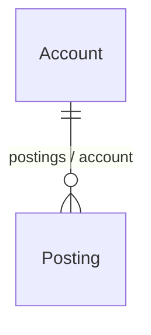

<!-- Written by eogen from the Ledger model. Change the model, and run eogen's doc goal, rather than editing this page. -->

Ledger
======

A ledger, with an entity index and stored procedures, which Project Wonder's models don't have.

Account
-------

- Table: `account`
- Class: `com.example.ledger.Account`

| Attribute | Column | Type | Allows null | Documentation |
|---|---|---|---|---|
| `id` (primary key) | `id` | `INTEGER` | no |  |
| `name` | `name` | `VARCHAR(100)` | no |  |
| `number` | `number` | `VARCHAR(16)` | no |  |
| `openedOn` | `opened_on` | `DATE` | yes |  |

| Relationship | Destination | Cardinality | Documentation |
|---|---|---|---|
| `postings` | [Posting](#posting) | to many |  |

| Entity index | Attributes | Constraint | Documentation |
|---|---|---|---|
| `account_number` | `number` | distinct | Account numbers are unique. |

Posting
-------

- Table: `posting`
- Class: `com.example.ledger.Posting`

| Attribute | Column | Type | Allows null | Documentation |
|---|---|---|---|---|
| `accountID` | `account_id` | `INTEGER` | no |  |
| `amount` | `amount` | `DECIMAL(38, 4)` | no |  |
| `id` (primary key) | `id` | `INTEGER` | no |  |
| `postedAt` | `posted_at` | `TIMESTAMP` | no |  |

| Relationship | Destination | Cardinality | Documentation |
|---|---|---|---|
| `account` | [Account](#account) | to one, mandatory |  |

Stored procedures
-----------------

| Stored procedure | External name | Arguments | Documentation |
|---|---|---|---|
| `closeAccounts` | `close_accounts` | `before`, `closed` |  |
| `fetchAccounts` | `fetch_accounts` |  |  |
