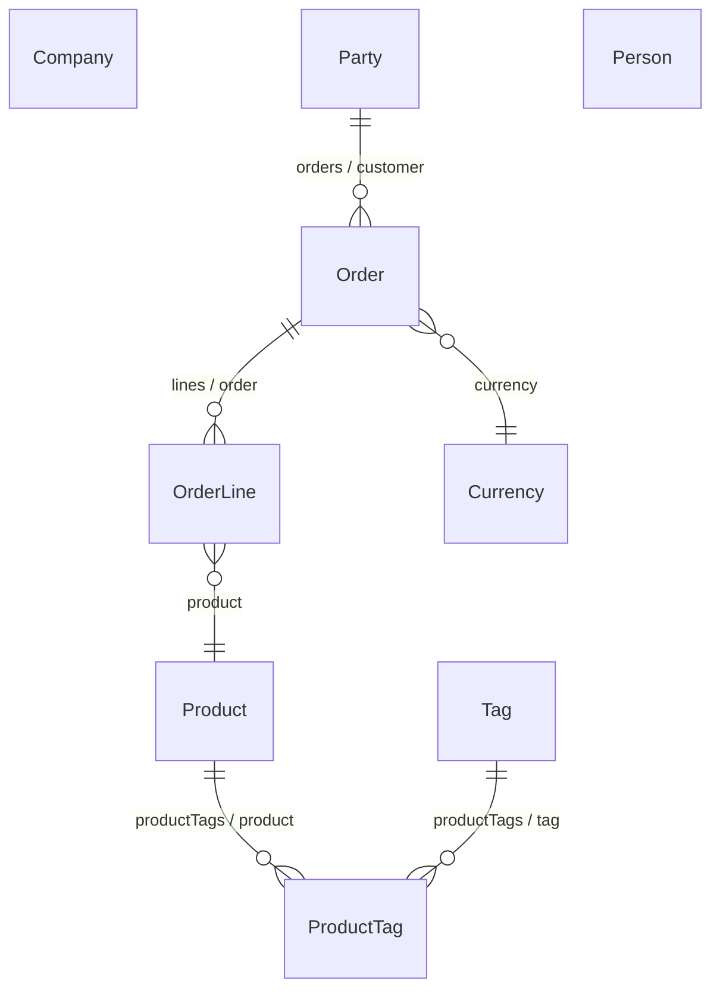

<!-- Written by eogen from the Shop model. Change the model, and run eogen's doc goal, rather than editing this page. -->

Shop
====

A small shop, for testing eogen.

Company
-------

- Table: `party`
- Class: `com.example.shop.Company`
- Parent: [Party](#party)
- Restricting qualifier: `(type = 'C')`

| Attribute | Column | Type | Allows null | Documentation |
|---|---|---|---|---|
| `taxNumber` | `tax_number` | `varchar(100)` | no |  |

Order
-----

- Table: `shop_order`
- Class: `com.example.shop.Order`

| Attribute | Column | Type | Allows null | Documentation |
|---|---|---|---|---|
| `currencyCode` | `currency_code` | `varchar(100)` | no |  |
| `customerID` | `customer_id` | `integer` | no |  |
| `customerName` | via `customer.name` |  |  |  |
| `id` (primary key) | `id` | `integer` | no |  |
| `note` | `note` | `text` | no |  |
| `placed` | `placed` | `timestamp` | no | When the order was placed. |
| `total` | `total` | `numeric(12, 2)` | no |  |

| Relationship | Destination | Cardinality | Documentation |
|---|---|---|---|
| `currency` | Currency | to one, mandatory |  |
| `customer` | [Party](#party) | to one, mandatory | The <code>Party</code> who placed the order. |
| `lines` | [OrderLine](#orderline) | to many | What was ordered, one line for each <code>Product</code>.  Deleting an order deletes its lines. |

| Fetch specification | Qualifier | Documentation |
|---|---|---|
| `byCustomerName` | `customer.name caseInsensitiveLike $name and total > $minimum` |  |
| `recent` |  |  |

OrderLine
---------

- Table: `order_line`
- Class: `com.example.shop.OrderLine`

| Attribute | Column | Type | Allows null | Documentation |
|---|---|---|---|---|
| `id` (primary key) | `id` | `integer` | no |  |
| `orderID` | `order_id` | `integer` | no |  |
| `price` | `price` | `numeric(12, 2)` | no |  |
| `productID` | `product_id` | `integer` | no |  |
| `quantity` | `quantity` | `integer` | no |  |

| Relationship | Destination | Cardinality | Documentation |
|---|---|---|---|
| `order` | [Order](#order) | to one, mandatory |  |
| `product` | [Product](#product) | to one, mandatory |  |

Party
-----

Someone who places orders.

- Table: `party`
- Class: `com.example.shop.Party`
- Subentities: [Company](#company), [Person](#person)
- Abstract

| Attribute | Column | Type | Allows null | Documentation |
|---|---|---|---|---|
| `email` | `email` | `varchar(100)` | no |  |
| `id` (primary key) | `id` | `integer` | no |  |
| `name` | `name` | `varchar(100)` | no |  |
| `status` | `status` | `varchar(50)` | no |  |
| `type` | `type` | `varchar(100)` | no |  |

| Relationship | Destination | Cardinality | Documentation |
|---|---|---|---|
| `orders` | [Order](#order) | to many |  |

Person
------

- Table: `party`
- Class: `com.example.shop.Person`
- Parent: [Party](#party)
- Restricting qualifier: `(type = 'P')`

| Attribute | Column | Type | Allows null | Documentation |
|---|---|---|---|---|
| `dateOfBirth` | `date_of_birth` | `timestamp` | no |  |

Product
-------

- Table: `product`
- Class: `com.example.shop.Product`

| Attribute | Column | Type | Allows null | Documentation |
|---|---|---|---|---|
| `active` | `active` | `varchar(5)` | no |  |
| `category` | `category` | `integer` | no |  |
| `id` (primary key) | `id` | `integer` | no |  |
| `name` | `name` | `varchar(100)` | no |  |
| `price` | `price` | `numeric(12, 2)` | no |  |

| Relationship | Destination | Cardinality | Documentation |
|---|---|---|---|
| `productTags` | [ProductTag](#producttag) | to many |  |
| `tags` | [Tag](#tag) | to many, via `productTags.tag` |  |

ProductTag
----------

- Table: `product_tag`
- Class: `EOGenericRecord`

| Attribute | Column | Type | Allows null | Documentation |
|---|---|---|---|---|
| `productID` (primary key) | `product_id` | `integer` | no |  |
| `tagID` (primary key) | `tag_id` | `integer` | no |  |

| Relationship | Destination | Cardinality | Documentation |
|---|---|---|---|
| `product` | [Product](#product) | to one, mandatory |  |
| `tag` | [Tag](#tag) | to one, mandatory |  |

Tag
---

- Table: `tag`
- Class: `com.example.shop.Tag`

| Attribute | Column | Type | Allows null | Documentation |
|---|---|---|---|---|
| `id` (primary key) | `id` | `integer` | no |  |
| `name` | `name` | `varchar(100)` | no |  |

| Relationship | Destination | Cardinality | Documentation |
|---|---|---|---|
| `productTags` | [ProductTag](#producttag) | to many |  |
